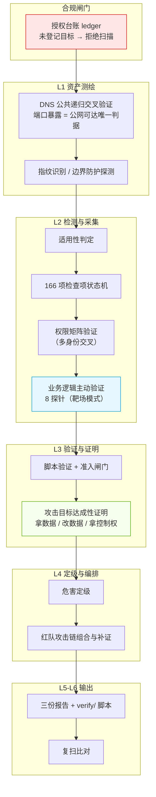

# aiscan — AI 驱动的黑盒安全扫描器


> **一个由 AI Agent 调度执行的黑盒 Web 安全扫描器：零 API Key、166 项固定检查项、
> 每条结论都来自真实执行、每个漏洞配可独立复现的脚本。**
> 在 OWASP Juice Shop v20.2.0 官方基准上实测召回率 **64/80 = 80.0%**。

---

## 为什么值得看一眼

| 卖点 | 实测数据 / 做法 |
|---|---|
| 🎯 **基准可复现，不是自说自话** | 对照 OWASP Juice Shop v20.2.0 官方答案表，真分母 80 项，实测 **64/80（80.0%）**；跑法、账号夹具、计分器全部开源在 `bench/` |
| 🤖 **覆盖 LLM 应用攻击面** | 内置 `EXT-AI-*` 检测族：提示词注入、系统提示词泄露、AI 调试信息泄露、Chatbot 越权——当下最热、多数扫描器还没有的面 |
| 🧠 **AI 驱动，但结论确定** | 扫描流程由 AI Agent 调度（自动判定危害、深度验证、串联证据链）；检测器本身是确定性逻辑，同一目标重复跑结果一致 |
| 🚫 **禁止「假通过」** | 三态判定：通过 / 不通过 / 待确认。**没有检测代码的项不会默认「通过」**——这条设计历史上让 42 项假通过现形 |
| 🔑 **零 API Key** | 不依赖任何云端服务与大模型接口，离线可跑；缺 nuclei / sqlmap 自动降级并在报告中标注 |
| 📦 **拷过去就能用** | `install.cmd` 一键部署：自动找 Python、建隔离 venv、装依赖、跑自测 |

## 30 秒上手

```bash
# 1. 一键部署（Windows）：双击 install.cmd 即可，或在 PowerShell 中执行 install.ps1
#    装了 WorkBuddy 的机器自带 Python，无需另装

# 2. 登记授权（合规闸门：未登记的目标会被引擎拒绝 —— 这是设计，不是故障）
.venv\Scripts\python.exe aiscan.py ledger --register example.com --name 示例系统 --authorizer 张三 --ref "邮件2026xxxx"

# 3. 开扫
.venv\Scripts\python.exe aiscan.py scan --target example.com --name 示例系统 --profile standard
```

完整安装、配置、基准复现与常见坑见 **[部署手册.md](部署手册.md)**。

## 它跑起来长这样

```text
$ python aiscan.py checklist

  AI 驱动安全扫描工具链

检查项总量：166 项
  WSTG 骨架   ：118 项（OWASP WSTG master (13 categories / 116 test items)）
  场景扩展    ：48 项
  适用条件变量：19 个

分类           名称                    项数
----------------------------------------
INFO         信息收集                  10
CONF         配置与部署管理             15
IDNT         身份管理                   5
ATHN         身份认证                  11
ATHZ         授权                      5
...
```

一次扫描的产出（`outputs/<系统名>/<时间戳>/`）：

| 产物 | 用途 |
|---|---|
| `*_技术版报告.md` | 完整七章技术报告，含复现脚本 |
| `*_扫描通告.md` | 固定格式，直接贴部门大群 |
| `*_管理层摘要.md` | 一页纸，给领导看 |
| `*_findings.json` | 结构化数据，供复扫比对 |
| `verify/` | **每漏洞一份可独立执行的验证脚本** |

## 架构总览



**AI 在哪一层**：调度与复核（自动判危害、选验证路径、串证据链），不是检测器本身——检测器是确定性逻辑，所以结果可复现。

## 定位说明（先说清边界，免得误会）

- ✅ **AI 驱动**：指扫描流程由 AI Agent 调度与复核——自动判定危害、做深度验证（拿数据 / 改数据 / 拿控制权）、串联证据链。
- ✅ **含 AI 攻击面检测**：内置 LLM 应用检测族，能测 Chatbot 提示注入、系统提示词泄露。
- ⚠️ **不是「用大模型猜漏洞」**：检测器是确定性逻辑，不靠 LLM 生成结论，因此可复现、无幻觉、零 Key。
- ⚠️ **诚实口径**：基准 64/80 中未命中的 16 项（AI 强模型挡下的 3 项、靶场无利用面的 9 项、方差 1 项等）在手册中逐项列明，**不为好看而虚报**。

## 基准成绩（Juice Shop v20.2.0，真分母 80）

| 版本 | 命中 | 召回率 | 变化 |
|---|---|---|---|
| 基线（旧天花板） | 57 | 71.2% | — |
| + 业务逻辑主动验证（8 探针） | 61 | 76.2% | +4 |
| + 权限矩阵夹具修复 | **64** | **80.0%** | +3 |

复现命令、测试账号夹具、跑法铁律见 `部署手册.md` 第 7 章与 `bench/`。

## 目录导览

| 路径 | 内容 |
|---|---|
| `engine/` | 扫描引擎与检测体（含 `business_active.py` 业务逻辑主动验证、`checks/` 各检查族） |
| `bench/` | 基准体系：答案表 + 计分器（可复现 64/80） |
| `checklist/` `rules/` `config/` | 166 项检查项清单、判定规则、扫描档位 |
| `tools/` | 辅助工具（含靶场 LLM 后端接线脚本） |
| `部署手册.md` | 安装 / 上手 / 合规红线 / 基准复现 / FAQ |

## 许可与免责

MIT 许可。**仅限用于你有权测试的系统**——未授权扫描违法；本工具内置授权台账闸门（`ledger --register`）正是为此设计。作者不对滥用行为负责。

---

---

## 一、这套工具解决什么问题

传统扫描器的问题：
- **只报不证** —— 报一堆"疑似"，研发无法判断真假，最后整份报告不被信任
- **CVSS 定级脱离实际** —— 技术分很高但实测只返回空数据，也标"严重"，虚报导致报告贬值
- **每次扫的项不一样** —— 无法横向比对，也无法证明"哪些没查"
- **业务逻辑漏洞扫不出** —— 越权、优惠券叠加这类最值钱的问题，任何扫描器都发现不了

这套工具的四个针对性设计：

| 设计 | 做法 |
| --- | --- |
| 每条漏洞都有复现脚本 | 每个漏洞生成一份可独立执行的 `verify_xxx.py`，含断言、预期结果、实测结果 |
| 按实测危害定级 | 定级看"实测能拿到什么数据 / 什么权限"，不看 CVSS 分值；证据不足的一律降级 |
| 检查项固定且全量报备 | 166 项固定清单，**不适用的项也逐项说明原因**，附复核清单 |
| 单列扫描器盲区 | 业务逻辑与权限矩阵错位单独成章，配多账号交叉验证 |

### 第五条设计（v2 新增）：结论必须来自真实执行

前四条解决的是"报得准"，第五条解决的是"**报得诚实**"。

早先版本的报告层用了一条看起来合理的规则：*适用 且 未发现问题 → 通过*。
这条规则有个致命缺陷 —— 如果一个检查项**根本没有对应的检测代码**，
它同样不会产出发现，于是也被标成"通过"。实测报告里 55 项"通过"中，
有 42 项属于这种情况：不是"测了没问题"，而是"压根没测"，却被包装成已验通过，
研发据此关掉了整改任务。

现在每一项的结论由「**逐项执行状态机**」产出，状态互斥：

| 状态 | 含义 |
| --- | --- |
| 通过 | 检测器**完整执行完毕**且未发现问题。这是唯一能叫「通过」的情况 |
| 不通过 | 检测器执行完毕并产出了问题 |
| 未执行 | 适用，但无检测逻辑 / 检测器执行失败 / 前置条件不足 —— **没结论，不代表安全** |
| 待人工执行 | 必须人工判断，已附可照做的操作步骤 —— **没结论，不代表安全** |
| N/A | 目标不具备该特征，逐项说明原因 |
| 待确认 | 适用性无法从外部判定 |
| 已跳过 | 使用者显式跳过 |

配套两道机械化校验，保证这件事不会随时间退化：

```bash
python aiscan.py coverage --strict   # 断言 166/166 全部绑定执行体，有缺口直接非零退出
python aiscan.py selftest            # 离线自测：验证「没测」不会被报成「通过」
python aiscan.py audit               # 探测强度审计：查「一次请求没发却下了结论」的项
```

`selftest` 会在本地起一个故意埋了问题的假应用，把 166 项全跑一遍，
校验五条不变量：状态合法、**通过必须有执行凭据**、非通过必须有原因、
人工项步骤完整、埋点必须被命中。全程不外网（DNS / crt.sh / 端口扫描均已打桩），
可反复运行。当前实测结果：**137 项自动执行 / 106 通过 / 31 不通过 / 26 待人工 / 0 未执行**。

> 注意：`selftest` 里 26 项"待人工执行"是设计使然，不是缺陷 ——
> 业务逻辑、多账号越权、真实副作用验证这几类，自动化判不出来，
> 强行写个"未发现问题"的函数才是真正的问题。

---

## 二、快速开始

> **要在另一台电脑上跑？** 不用手动配环境 —— 见第十五章「跨机部署」。
> 开发机上 `python make_dist.py` 打包，目标机上解压后双击 `install.cmd` 即可。

### 环境准备

本机首次使用：直接跑 **`install.ps1`** 最省事（它会建 venv、装依赖、探测工具链、跑自检）；
想手动来也行：

```bash
# 依赖（已安装可跳过）
pip install -r requirements.txt

# 探测本机可用工具（nuclei / nmap / sqlmap 等可选，缺失会自动降级）
python aiscan.py tools
```

### 第一次扫描

```bash
# 1. 登记授权（每个目标只需登记一次，之后免问）
python aiscan.py ledger --register example.com --name "示例系统" \
    --authorizer 张三 --ref "邮件《安全评估申请》20260920"

# 2. 执行扫描
python aiscan.py scan --target example.com --name "示例系统"

# 3. 查看结果
#    产出在 outputs/示例系统/<时间戳>/ 下：
#      示例系统_技术版报告.md      完整七章，含复现脚本
#      示例系统_扫描通告.md        固定格式，直接贴部门大群通晒
#      示例系统_管理层摘要.md      一页纸，给领导看
#      示例系统_findings.json      结构化数据，供复扫比对
#      示例系统_渲染留痕.json      本次渲染拿到了哪些运行期上下文（判断报告是否完整）
#      verify/                     每漏洞一份可独立执行的验证脚本
```

### 常用命令

```bash
python aiscan.py checklist                    # 查看 166 项检查清单统计
python aiscan.py checklist --show WSTG-INPV-05  # 看某一项的完整定义
python aiscan.py profiles                     # 查看三个扫描档位
python aiscan.py ledger                       # 查看授权台账
python aiscan.py diff --target 示例系统        # 与上次扫描比对
python aiscan.py batch                        # 按 targets.yaml 批量扫描（忽略周期，全扫）
python aiscan.py schedule                     # 周期化判定：谁该跑、谁不该跑、为什么（只看不跑）
python aiscan.py schedule --run               # 只执行到点的目标，跑完自动记账并按需发通知
python aiscan.py schedule --run --notify-test # 同上，但飞书卡片只渲染不发送（试发）
python aiscan.py creds --target example.com   # 需要登录令牌时：告诉我去哪拿、怎么给
python aiscan.py creds --target example.com --set user_a --from-clipboard  # 写进本机凭据库
python aiscan.py creds --target example.com --verify         # 回验登录态是否真的成立
python aiscan.py creds --target example.com --clear user_a   # 用完清掉（不留残凭据）
python aiscan.py coverage --strict            # 校验 166 项是否全部有检测器（CI 可挂）
python aiscan.py selftest                     # 离线自测引擎，不外网
python aiscan.py selftest --verbose --report /tmp/st   # 自测并渲染示例报告
python aiscan.py audit --json audit.json  # 逐项探测强度审计，缺陷项非零退出
python run_all_tests.py                       # 全量回归：上面这些 + 靶场 + 红队 + 调度 + 凭据，一条命令
python sync_copies.py --check                 # 三副本一致性检查（部署前跑）
python sync_copies.py                         # 同步到两份部署副本，并逐副本跑覆盖率校验
                                              # 副本若比开发副本新，直接拒绝同步并列出差异文件
                                              # （照着副本改完再从副本执行，会把自己的改动覆盖掉）
python sync_copies.py --merge-ledger          # 三处授权台账取并集写回三处（只增不删，先留底）
python sync_copies.py --ledger-self-test      # 只看台账合并语义自测（临时目录，不碰真实台账）
```

---

## 三、命令详解

### `scan` — 执行扫描

| 参数 | 说明 |
| --- | --- |
| `--target` | 目标域名（必填） |
| `--name` | 目标系统名称，用于报告标题与归档目录 |
| `--url` | 指定入口 URL，默认 `https://<域名>` |
| `--profile` | 档位：`safe` / `standard`（默认）/ `deep` |
| `--authz` | 启用权限矩阵验证（需配 `--accounts`）。**默认已是自动**：检测到 ≥2 个回验通过的测试身份就自动跑，本开关用于显式强制 |
| `--no-authz` | 显式关闭权限矩阵（无账号或不想让它跑时使用） |
| `--accounts` | 测试账号配置文件 |
| `--features` | 特征预置 JSON（跳过指纹识别，加快速度） |
| `--skip-auth` | 跳过授权闸门（**仅限内部自测**） |

### 三个扫描档位

| 档位 | 速率 | 单主机 | 项间间隔 | 适用场景 |
| --- | --- | --- | --- | --- |
| `safe` | 5 rps / 并发 2 | 3 rps | 200 ms | 生产核心系统首扫、业务高峰时段。**禁止任何写方法** |
| `standard` | 20 rps / 并发 8 | 10 rps | 50 ms | 默认。常规扫描，允许只读语义的 POST |
| `deep` | 100 rps / 并发 20 | 50 rps | 0 | 测试环境专用。全量方法 + 受控写验证 |

**任何档位都不可突破的硬约束**（`config/profiles.yaml` 的 `hard_limits`）：
- 禁止 DoS / 压测类模板
- 禁止破坏性写（删库、删文件、不可回滚的更新）
- 禁止对第三方（非授权目标）发起请求
- 禁止上传可执行文件（webshell）
- **速率不超过 200 rps** —— 超出的档位会被收敛到该值，并在报告的「防护有效性」一节
  留痕（收敛只影响耗时，不影响检查项覆盖）。nuclei 通道同样受约束，
  否则「一条通道合规、另一条绕过硬上限」的硬上限就不是硬上限。
- **运行期停止条件**：目标连续 10 次返回 5xx（跨 ≥2 个不同 URL）、
  或响应时间突增至基线的 10 倍且连续 3 次（绝对值 ≥0.8s）→ **立即停手**，
  剩余检查项记「未执行」。停手不退避重试：这不是限流，是服务可能已经异常，
  继续施压只会加重故障且后果不可逆。

> ⚠ 停止条件的报告措辞与「被边界拦截」**严格区分**，两者不得混读：
> 被拦截是「请求**没到达**应用」（拿到的是拦截页，排查方向是 WAF 白名单）；
> 停止条件是「请求**到达了**应用、应用自己在返错」（排查方向是服务端为什么异常，
> 且若由本次扫描造成，属我方对目标的影响，应同步告知系统负责人）。

档位只调整**扫描强度与速率**，不改变检查项范围 —— 无论哪一档，166 项全部执行并逐项报备。

**`hard_limits` 的维护规矩**：这里每一条都必须有代码执行体，且要在 yaml 注释里写清
是谁在读。一条「配了却没人读」的硬约束比不写更危险 —— 它给出的是**虚假保证**：
操作者据此认为有兜底，实际扫描器不会照做。回归里有一环
（`selftest_hardlimits.py`）专门钉住这件事，把「字段被读到并真的改变了行为」变成断言。

### `ledger` — 授权台账

```bash
# 登记
python aiscan.py ledger --register <域名> --authorizer <授权人> --ref <授权依据>

# 允许受控写验证（须授权书明确写明）
python aiscan.py ledger --register <域名> --authorizer <授权人> --ref <依据> --allow-write

# 查看
python aiscan.py ledger

# 移除
python aiscan.py ledger --remove <域名>
```

未登记的目标会被**拒绝执行**，并给出补登记指引。这是为避免"未授权扫描"这一合规风险的闸门。

**台账的存放位置与三副本一致性（易被忽略，但必须一致）：**

台账默认落在 `ledger/auth-ledger.yaml`，路径**相对引擎自身目录**。所以三份副本各有
一份台账 —— 如果放任不管，同一条扫描命令从不同副本跑会得到不同结论：

```
开发副本      0 条   → 任何目标都被拒绝
副本1（skill） 2 条   → internal-app.example.com 放行
副本2（探测） 1 条   → 同一目标被拒绝
```

这不只是"配置不同"，而是**同一个资产到底有没有授权出现了两个答案**；同时台账是审计
凭证，扫描次数分散在多处累加，审计链是断的。因此：

- `sync_copies.py` 每次运行都会校验三处台账，**不一致即判失败**（不允许静默分叉）；
- 台账**不走**普通文件同步那条路（那条是「dev 覆盖副本」的单向语义，会丢掉副本里
  dev 没有的授权记录），只由 `--merge-ledger` 以**并集**方式写回三处，改前自动留底；
- 合并取 `scan_count` 的**最大值而非求和**，保证幂等（若求和，每合并一次数字翻一倍）；
- 自测/占位记录（如 `example.com`）**只提示，不自动清理** —— 自动抹掉一条记录
  等于篡改审计链，清不清由人决定：`python aiscan.py ledger --remove example.com`。

> **对外分发副本前请注意**：台账记录的是内部资产名与授权依据。把整个 toolchain
> 打包给同事时，应清空台账，避免把资产清单带出去、也避免让同事误以为已被授权。

---

### `creds` — 持账号的认证态测试（**另一类工作**）

登录之后的越权是「最容易被拿走数据的一类问题」，而它不在任何匿名扫描的视野里。
要看见它，前提是扫描器先成为一个合法的登录用户 —— 于是「令牌从哪来」就成了
绕不过去的一步。

**先把定位说清楚**：这是一条**独立的链路**，不是红队入场方式的缺口。
红队零凭据入场，靠自己找入口、自己识别产品查默认口令、自己上网找线索
（见下一节）；**持账号**做越权 / IDOR / 横向 / 并发会话测试，则需要业务方
提供一个专用测试账号。两者结论在报告里分列，不混记 ——
把「有账号才能做的测试」写成「本次扫描的缺口」，会让人以为这一轮没做完整。

### 取号决策链（账号问题一律先自取，四条按序走）

需要测试身份时不再默认「等人给账号」，扫描器按下面四条顺序自己解决：

| 序 | 路 | 模块 | 说明 |
| --- | --- | --- | --- |
| 1 | **开放注册自建** | `engine/regself.py` | 目标有开放注册（JSON API 或 HTML 表单，带 CSRF 也认；遇验证码具名退场）→ 自己注册 2 个专用测试号，随机强口令，登录回验后写入本机凭据库。**门控两把锁**：deep 档 + 台账 `--allow-write`（注册在服务端创建持久状态，性质是受控写）；`AISCAN_REGSELF=off` 一票否决；每轮最多 2 个，凭据库已有 `regself_` 身份则跳过（季度扫描不刷号） |
| 2 | 默认口令受控尝试 | `credhunt.py` | 认产品 → 查出厂默认口令，双重上限 12/3、命中风控即停 |
| 3 | 联网检索泄露凭据 | `credosint.py` | 只产候选，提交一律走受控循环 |
| 4 | 待人工执行 | 检查项状态机 | 全部失败 → 如实记「待人工」+ 报告写清补齐路径，**不写成通过** |

自取身份与人工给的身份在会话池里同级使用：合成自动登录时带字段名
（`email` / `pass` 这类真实表单字段）与成功判据（token-in-body 或 Cookie），
回验页由**匿名对照实验**选定（匿名 401/403 + 带凭据 200 才有区分力）。

过去这里是**静默的终点**：扫描发现需要账号，只记一句「未配置测试账号」然后降级成
「未执行」，没人知道该去哪拿、怎么给，那几项就永远补不上。现在它是一个闭环：

```
扫描发现需要登录态 → 主动给出「去哪拿」的证据与步骤
    → 你把令牌写进本机凭据库（不经对话）
        → 回验「真的登进去了」→ 重扫，被挡住的项自动开始执行
```

```bash
python aiscan.py creds --target example.com          # 看缺什么、去哪拿、怎么给
python aiscan.py creds --target example.com --init   # 生成骨架（占位，不含真实凭据）
python aiscan.py creds --target example.com --set user_a --from-clipboard
python aiscan.py creds --target example.com --verify # 回验登录态是否真的成立
python aiscan.py creds --target example.com --clear user_a
```

**凭据通道刻意不走对话。** 会话令牌等同于账号权限：贴进对话就进了 AI 上下文与
对话日志，而且**收不回来**（会话可以吊销，已扩散出去的副本不行）。所以这里只
把凭据写进本机文件、由工具自己读 —— 文件在工具目录之外，不会被三副本同步带走、
不会随报告打包、不会误提交到仓库。

#### 三条设计红线（都踩过坑）

1. **没有凭据的会话，不许判「已登录」。** 判据若是「带 Cookie 访问没被弹回」，
   而站点首页对游客也返回 200 —— 那么「什么凭据都没有的账号」会被判成已登录。
   实测后果：两个空账号就能满足「≥2 个已登录态」的门槛，扫描器随后以匿名身份
   去跑越权检测，产出一批复测不出来的「越权」。现在零凭据直接判「未提供凭据」，
   **且一个请求都不发**。
2. **回验必须带匿名对照。** 带凭据「没被弹回」本身不是证据 —— 一个随手编的
   假 Cookie 访问公开页同样 200。所以回验会再发一次**不带凭据**的对照请求：
   对照被挡、带凭据通过 → 会话有效（判「已登录」）；对照也放行 → 该路径毫无
   区分力 → 判「未验证」。**回验路径推荐在账号配置里指定 `verify_path`**
   （一个「需要登录才能访问」的页面），否则拿首页回验时登录态只能判「未验证」。
3. **「没配到凭据」与「登录失败」是两件事。** 前者该去补凭据，后者该去查账号
   密码。混写成「登录失败」等于在报告里说一句没发生过的事，把排查方向带偏。

扫描结束时若仍缺凭据，终端会打印完整指引，报告第 3 章单列
**「凭据缺口：需要登录令牌的检查」** 一节（去哪拿、怎么给、怎么验、怎么补跑，
以及受影响的检查项清单）。**这些项的状态不变** —— 凭据未到位时它们仍是
「未执行」，绝不会被写成通过。

---

### 红队的入场方式：凭据获取与凭据情报

真实攻击者手上没有测试账号。他零凭据入场，走的是三条路 —— 这三条工具都做了，
**默认不需要向任何人索取账号**：

| 黑客的路 | 工具的做法 | 依赖 |
|---|---|---|
| ① 找登录入口 | 复用指纹阶段探过的路径；必要时在已知路径清单内补探 | 无 |
| ② 这是什么系统、它的默认口令是什么 | 从指纹证据**识别产品** → 查**本地产品默认口令知识库** | 无 |
| ③ 有没有人已经泄露过 | 联网检索公开资料，产出候选与线索 | 需出网 |

第 ② 条是主力，也是命中率最高的一条：厂商文档、安装手册、镜像的
`docker-compose` 里都写着默认口令。**但它的前提是「先认出产品」** ——
认错了就等于拿 A 的口令去打 B 的登录框，几次失败登录留在对方日志里，
还平白消耗掉本就极少的尝试配额。所以产品识别只认**产品特有**的证据
（`/manager/html`、`/nacos/`、`Apache-Coyote` 头、页面里的产品标记），
`/login` 这种「是个登录框就有」的通用路径**不构成证据**。

候选口令能否直接拿去试，还要过一道**准入**：账号名须属通用运维账号集合，
口令须是默认 / 弱口令形态。检索回来的文本里可能混着别人的真实凭据，
自动使用会误伤无关账号、也超出「默认口令探测」的授权解释 —— 这类一律转人工，
并在报告里逐条写明原因（**静默拒绝与静默使用同样有害**）。

#### 联网检索是「尽力而为」，本地库才是可靠的那条腿

实测记录（2026-09-29）：

- 检索源对**连续查询**会返回 `HTTP 202` + `anomaly` / `challenge` 的机器人校验页；
- 做过 UA 对照实验：同一 IP、同一时刻只换 UA 对打三枪，**自报扫描器身份与
  普通浏览器 UA 结果完全一样，都被校验** → 不是 UA 特征，是**查询频率 / IP 级限流**。
  所以换 UA 解决不了，该做的是控频（`MIN_QUERY_GAP`，两次检索强制间隔 4 秒）
  并在被限流时**如实说出来**；
- 被限流后**立即停止**后续检索。继续打只会延长校验期，而把「没检索成」
  写成「没找到线索」是最坏的一类假结论 —— 读者会以为公开渠道已经查干净了。

因此：**识别产品 + 本地默认口令库不依赖网络，是稳定可用的那部分**；
联网那一段拿不到结果时会在报告里具名说清是哪一种（限流 / 网络不可达 /
对端改版），并给出已生成的检索词供人工用浏览器补。

#### 对外检索会暴露「有人在关注该目标」，因此必须披露

向外部检索源发出查询，本身就是一次对外动作：第三方由此知道有人在查这个目标。
所以报告 4.1 节会**逐条列出本次发出的检索词**，`findings.json` 里同步落盘。
两个开关：

```bash
python aiscan.py scan --target example.com --no-credosint-online  # 只关联网检索（保留本地库）
python aiscan.py scan --target example.com --no-credosint         # 完全关闭凭据情报
```

环境变量 `AISCAN_CREDOSINT=off` 等价于后者。**非公网目标**（回环 / 内网地址 /
`.local` 名称）自动不做联网检索并说明原因 —— 对 `127.0.0.1` 做公开检索没有意义，
附带的好处是离线自测天然保持离线。

安全档 (`safe`) 恒不做任何外部检索。所有实际的口令提交仍走凭据获取那一个受控循环，
因此「双重次数上限 / 命中风控即停 / 口令原文不落盘 / 同源约束」四条约束
对所有候选一体生效。

---

## 四、检查项清单（166 项）

| 来源 | 规模 | 文件 |
| --- | --- | --- |
| OWASP WSTG master（已逐项核对官方仓库） | 117 项 / 13 分类 | `checklist/checklist-wstg.yaml` |
| 场景扩展（云 / 供应链 / CI-CD / AI / 域名邮件 / 数据隐私 / 滥用防护） | 46 项 / 7 分类 | `checklist/checklist-extras.yaml` |

**每一项固定 7 个字段**：

```yaml
- id: WSTG-ATHN-01
  name: 凭据经加密通道传输
  app: has_login                     # 适用条件变量，用于自动判 N/A
  detect: 检查登录请求是否走 HTTPS / 是否存在 HTTP 回退
  verify: 脚本模拟登录请求并检查传输通道
  level: 明文传输凭据 → 高危；仅弱套件 → 中危
  compliance: 等保2.0 8.1.4.2 / PCI-DSS 4.1
```

**关键在 `app` 字段**：它让工具能自动判定"这一项适不适用"，从而对不涉及的项输出
`N/A：该目标无认证流程，WSTG-ATHN-01 不适用`，而不是默默跳过。

适用条件已枚举为 19 个变量（`always` / `has_login` / `has_api` / `has_upload` / `has_payment` / `has_oauth` / `has_graphql` / `has_storage` / `has_ai` 等）。

**166 项的检测能力分布**（`python aiscan.py coverage`）：

| 执行方式 | 项数 | 说明 |
| --- | --- | --- |
| 自动检测器 | **137** | 有明确检测逻辑，能跑出可复现证据 |
| 人工执行指引 | **26** | 必须人判（业务语义 / 多账号 / 真实副作用 / 内部资料），已附操作步骤与判定标准 |
| 未绑定 | **0** | 有缺口时 `coverage --strict` 会直接失败，不会悄悄放行 |

自动项按风险分级，由扫描档位控制是否执行：

| 档位 | 允许执行的检测 |
| --- | --- |
| `RISK_SAFE` | 纯被动读取（响应头、页面内容、公开日志），任何档位都跑 |
| `RISK_STANDARD` | 常规主动探测（路径探测、参数注入、端口连通性） |
| `RISK_DEEP` | 有副作用或易触发风控（默认口令尝试、注入探针、表单提交）。低档位下会落进"未执行"并注明原因 |

`RISK_DEEP` 类检测额外受三重约束：必须 deep 档 + 单次检查提交次数有上限（默认 6 次，
且不做重试，避免把真实账号锁死）+ 每次提交都记入审计并在报告第 7 章逐条披露。

---

## 五、定级标准

以**实测危害**为准，不套 CVSS 分值。

| 级别 | 判定条件（须实测支撑） |
| --- | --- |
| 严重 | 实测可直接获得系统控制权或全量数据 |
| 高危 | 实测可获取有效业务数据 / 越权权限 / 篡改数据并生效 |
| 中危 | 路径可达且有技术证据但未实证危害，或危害仅限本人账号 |
| 低危 | 仅攻击面暴露，无直接危害路径 |
| 信息 | 配置优化建议 |

**降级因子**（每命中一项降一级）：需已认证身份 / 需特定角色 / 需用户交互 / 需罕见环境 / 版本区间无法确认
**升级因子**（每命中一项升一级）：无需认证 / 可跨用户跨租户 / 可批量利用 / 触及生产数据

**证据分级与定级上限联动**：

| 证据级别 | 说明 | 定级上限 |
| --- | --- | --- |
| A | 确证可达（成功结构 / 文件流 / 业务错误码） | 可参与严重、高危定级 |
| B | 路由存在无鉴权（无参返回 400 缺参） | 上限中危 |
| C | 无法确证（404，且伪路径对照响应一致） | **不进入漏洞清单**，列入待确认 |

定级引擎会输出**完整推导链**（基线 → 证据上限 → 因子修正 → 安全阀），写在报告的「定级依据」段，可审计。

**两条「证据先归属、再采信」的规则**（2026-09-28 两次实测踩坑后固化，均有自测不变量钉住）：

- **复现脚本的目标地址必须等于「发现所在的端点」**。桶类发现的端点是目标自有的
  OSS / COS / S3 桶，它**不是站点的子域**；若框架按「同主机 / 子域」判据回落，
  脚本就会去打网站首页 —— 而网站对任意路径都返回同一张 HTML，
  脚本据此判「自定义错误页，非真实暴露」，于是一条**实测存在的严重暴露**
  被准入闸门挡在漏洞清单外，报告上只写「未复现，可能已修复」。
  修法是检测器用 `Finding.extra["repro_base"]` **显式声明**端点（不让框架猜主机名），
  并保留反向约束：第三方情报源（crt.sh 等）与「前缀像目标」的站外主机仍回落。
- **CORS 头必须能归属到应用才算证据**。**405 / 5xx** 是通用错误页 / 边缘页，
  其上的 `Access-Control-Allow-Origin` 可能由 WAF、网关统一添加，归不到端点配置；
  **401 / 403 且整站同码**时同样不采信。不采信时判**待确认** ——
  既不上报（会产出复测不出来的误报），也不判「未发现缺陷」（那是用一个
  不可采信的响应把风险判定掉）。响应状态码必须写进证据，便于一眼看出证据来源。

---

## 六、报告结构（固定七章）

1. **执行摘要** — 范围、**执行落实情况**（真的跑了多少 / 未执行多少）、结论分布、总体评级、Top 3 待处置
2. **授权与范围声明** — 授权人、依据、DNS 交叉验证结果
3. **全量检查项结论表** — 166 项逐项标注（通过 / 不通过 / **未执行** / **待人工执行** / N/A，均附原因）
   - 分类明细表含「执行方式」与「证据类型」两列，能看出每项结论是怎么来的
   - **未执行清单**（含按原因归类的补齐方式）
   - **待人工执行清单**（逐项给出：为什么必须人工 + 操作步骤 + 判定标准）
   - **弱判定 N/A 复核清单**
4. **漏洞详情** — 每项含通俗描述、技术细节、复现脚本、实测记录、影响说明、定级依据、修复建议
5. **扫描器盲区专项** — 权限矩阵验证 + 业务逻辑人工验证清单
6. **合规对照** — 等保 2.0 / PCI-DSS 4.0 / ISO 27001 条款级映射
7. **附录** — 扫描参数、工具与版本、证据清单、**主动提交动作披露**、脱敏说明、免责声明

产出**三份**，读者与用途各不相同：

| 报告 | 读者 | 内容 |
| --- | --- | --- |
| **技术版** | 研发 / 安全工程师 | 完整七章，含复现脚本与证据 |
| **扫描通告** | 部门大群（通晒） | 固定格式，一条命令产出，直接可贴 |
| **管理层摘要** | 领导 | 一页纸，去技术细节与敏感信息 |

另落一份 `检查项结论.json`，逐项记录执行方式、状态、证据类型、探测次数与说明 ——
这是"哪些真的测了、哪些没测"的唯一凭据，复扫比对与审计都依赖它。

### 扫描通告（对外通晒版）

每扫完一个系统，要往部门大群发一份的那一份。它和另两份的差别不在排版，在**规矩**：

- **只列严重 / 高危 / 中危**，低危与信息类不列；但末尾必须说明"低危未列"，
  否则读者会以为已经列全了。
- **只列已实测复现的**发现。未能通过独立复现脚本验证的，一条都不进。
- **「防护有效性」是一节固定内容**，回答的是"这套防护到底挡住了什么"：
  边界有没有拦住、应用层有几处没守住。这条比"扫出几个洞"更该被先看到。
- **触达不了应用时不出漏洞统计**。一份"严重 0 / 高危 0 / 中危 0"的通告发进大群，
  等于对整个部门宣告"这个系统没问题"——而事实是"压根没测到"。
  这种情形下通告写的是相反的结论：**边界把外部攻击者挡住了（防护有效），
  但应用自身有没有问题，本次没有结论**。
- **复现步骤收敛掉可直接执行的命令**。通告要发到群里，群里有外包、代运维、
  历史遗留账号；一份原样带 `curl` 的通告等于把验证手册分发给所有能看到群消息的人。
  收敛后保留「打哪个地址、看到什么算复现成功」，负责人照样能自行确认。
  内部技术通道要完整命令时用 `--notice-repro full`。

```
python aiscan.py scan --target example.com --name "示例系统"    # 通告随扫描自动产出
python aiscan.py scan --target example.com --notice-repro full  # 保留完整复现命令
```

已扫过的目标想重新出通告（改格式 / 补晒）不必重扫，归档里有全部判定凭据。

### 边界拦截：A 类与 B 类在报告里怎么体现

边界拦截分两种，后果与处置完全不同，报告里必须分开写：

| | A 类「开扫即全量拦截」 | B 类「扫到一半被封」 |
| --- | --- | --- |
| 判定 | L1 边界判定（厂商特征 ∧ 随机不存在路径同页） | 运行期封禁守门（同源判据 + 基线对照） |
| 等待 | **无意义** —— 策略不是临时的 | 有意义 —— 退避 + 降速可能恢复 |
| 报告 | 「未触达应用」，全部自动项「未执行」 | 前段结论 + 封禁后「未执行」，窗口内结论按窗口作废 |
| 通告 | 写「被挡住」 | 写「实测命中的防护」「拦到什么程度」「没拦住的流量扫出了什么」 |

B 类有两个必须守住的点，都是 2026-09-29 实测事故换来的：

1. **终态是「持续状态」，不是「一次性事件」。** 守门转终态后不再抽检（省请求、
   也省对方的容忍度），但**门控判断必须继续成立** —— 逐项检测每个检查项都要
   先问一次「此刻是否仍被封」。两者曾经共用同一个标志位，结果是：封禁在 L2
   期间就成立时，逐项检测整段失去门控，166 项在拦截页上跑完。
   现在由 `BoundaryGuard.currently_blocked()` 独立回答状态，`tick()` 只管抽检。
2. **厂商名必须落在结构化字段里。** 命中了 `errors.aliyun.com` 却只在日志文本里
   写了一句 —— 报告层取不到，只能输出「厂商特征未确认」。证据在手上却没接到
   消费方，与判据缺失同样算错。现在厂商进 `BanEvent.vendor` / `GuardReport.vendor`
   / 短路标记三处，通告与技术版都直接引用，不解析文本。

另外两点判据口径：

- **端口类结论一律先过 TCP 对照实验**（`net.tcp_signal_trustworthy`）。
  沙箱代理 / 企业安全客户端 / 出口网关会透明接受任意 `connect()`，
  表现为「每个端口都开放」。判据是探若干个在正常主机上必然关闭的高位端口
  （49999 / 54321 / 65001）：只要有一个报「可连接」，本机到该目标的端口信号
  整体不可采信，端口类项一律「待确认」—— 既不报有，也不报无。
- **边界判定允许被后来的证据修正，但修正必须具名。** L1 判「未拦截」是当时
  的事实；运行期守门随后确认了厂商，报告就写下「判定修正（证据补足）」，
  而不是让「未拦截」与「命中拦截页特征」两个相反说法同时留在报告里。

### 「本轮没再看」不等于「没有问题」：承接清单

通告的问题清单**不会因为本轮没去复看就变成空的**。此前扫描上报过、而本轮状态属于
`未执行 / 待人工执行 / 待确认 / 已跳过 / 弱证据 N/A` 的项，会逐条承接过来，并写明
**「本轮未再检出不构成修复证据」**。

三个容易做错的地方：

1. **必须回溯多轮，不能只看上一轮。** 报过严重漏洞的那一轮，与 0 发现的那一轮，
   中间可能隔着一次运行 —— 只看上一轮会照样把漏洞丢掉。
2. **有结论就结案**（但只有**确证**的结论才算）。某一轮把某项判成「通过」或
   **强证据** N/A，就清掉更早的上报，不翻旧账；承接的前提是「本轮确实没看」。
3. **弱证据 N/A 不构成结论，也不构成推翻历史的证据。** 这是最容易漏的一条：
   弱 N/A 的确切含义是「有限路径探测**没看到**」，不是「确证不具备」。
   把它当结论会造出这种形态 ——
   第 N 轮 `has_storage` present → 对象存储桶匿名列举（严重）被实测证实；
   第 N+1 轮路径探测没命中 → 弱 N/A → **那份严重发现从通告里凭空消失**。
   所以：弱 N/A 在承接层按「没有结论」处理，在比对层也不得记为「已修复」。

   > 判据：`ItemResult.weak_na` 随 `检查项结论.json` 落盘；承接层
   > （`_collect_prior_unverified`）与比对层（`Differ.WEAK_NA_STATE`）都必须读它。
   > 比对层用独立的状态串 `N/A（弱证据）` 表示，**不混同于「N/A」** ——
   > 混用的后果是报告上写着「已修复 1」，而那一项只是没被看见。

承接项**不计入**本轮漏洞计数（既不算成「发现了」，也不掩盖成「没问题」），
且在通告与技术版里都出现 —— 技术版才是被存档、被逐条核对的那份。

### 归档覆盖守卫与降级自曝

`generate()` 会覆盖输出目录里的同名文件，因此**往已完成的归档里重渲染是危险动作**：
配一份残缺的上下文调它，报告不会报错，只会**静默地**成段塌陷
（`检查项` 显示 0 项、`需人工复核的 N/A 项` 显示 0 项），而同一目录的
`run-manifest.json` 还写着正确结论 —— 两份文件互相矛盾。2026-09-30 真的这么丢过一轮产出。

两道防线：

| 防线 | 行为 |
| --- | --- |
| **归档覆盖守卫** | 往含 `run-manifest.json` / `检查项结论.json` 的目录渲染 → 默认抛错。只有本轮编排器显式 `allow_archive_overwrite=True` 才放行。**要重渲染历史归档，渲染到另一个目录再比对，不要就地覆盖。** |
| **降级自曝 + 渲染留痕** | 每次渲染落 `<目标>_渲染留痕.json`，逐字段记录运行期上下文的填充情况；外来渲染且上下文残缺时，报告**首屏自曝「本报告为降级渲染」**、列出受影响章节、指明应以 `检查项结论.json` / `run-manifest.json` 为准。 |

**判据不是「字段是否为空」**：真实运行里 `credhunt` / `credosint` / `bypass_probes`
合法地可能为空（跑了、没命中）。降级判据是「**不是本轮运行**」**且**「关键字段有缺」，
由 `ReportContext.render_source` 显式声明来源。


---

## 七、脱敏与数据安全

扫描过程会采集响应内容、凭据、可能的 PII。**这些数据落盘前一律脱敏**，否则报告本身就成了新的泄露源。

| 类型 | 处理 |
| --- | --- |
| 凭据（云 AK/SK / JWT / Token / Cookie） | 保留前 4 位，其余打码 |
| PII（手机号 / 身份证 / 邮箱 / 银行卡） | 保留结构，中间打码 |
| 内网地址 | 内部版保留（便于定位），对外版抹除 |

每处证据附**原始内容哈希指纹**，用于证明证据未被篡改（哈希不可逆）。

两种脱敏档位：
- `internal`（技术版报告）：保留内网地址，便于研发定位
- `external`（管理层摘要 / 扫描通告 / 对外版本）：额外抹除内网地址

---

## 八、目录结构

```
aiscan/
├── aiscan.py                     统一 CLI 入口
├── targets.yaml                  目标清单（与扫描逻辑解耦，周期化扫描的数据源）
├── checklist/                    检查项总表 + 加载器 + 校验脚本
│   ├── checklist-wstg.yaml       WSTG 骨架 117 项
│   ├── checklist-extras.yaml     场景扩展 46 项
│   └── loader.py                 加载与强制字段校验
├── config/
│   └── profiles.yaml             三个档位 + 全局硬约束
├── engine/
│   ├── orchestrator.py           六阶段流程编排
│   ├── fingerprint.py            L1 资产测绘与指纹识别
│   ├── applicability.py          ★ 适用性判定（N/A 自动生成）
│   ├── registry.py               ★★ 逐项执行状态机 + 检测器注册表（消假阴性的核心）
│   ├── registry_runner.py        ★★ 把 166 项清单与检测器对接并汇总发现
│   ├── checks/                   ★★ 检测器实现（166 项全覆盖）
│   │   ├── base.py               共用助手：路径字典、模式集、真实命中判定
│   │   ├── net.py                网络层：端口、DNS、crt.sh、nmap
│   │   ├── recon.py              WSTG-INFO  信息收集 10 项
│   │   ├── config.py             WSTG-CONF  配置部署 15 项
│   │   ├── identity_auth.py      WSTG-IDNT / ATHN 身份与认证 16 项
│   │   ├── authz.py              WSTG-ATHZ  授权 5 项
│   │   ├── session.py            WSTG-SESS  会话 11 项
│   │   ├── injection.py          WSTG-INPV  输入验证 23 项
│   │   ├── error_crypto.py       WSTG-ERRH / CRYP 5 项
│   │   ├── business.py           WSTG-BUSL  业务逻辑 10 项
│   │   ├── client.py             WSTG-CLNT  客户端 15 项
│   │   ├── api.py                WSTG-APIT / WASM 5 项
│   │   ├── extras.py             EXT-SC / CL / CD 供应链·云·CI/CD 22 项
│   │   ├── extras2.py            EXT-AI     AI/LLM 应用 8 项
│   │   ├── extras3.py            EXT-DM     域名与邮件 6 项
│   │   └── extras4.py            EXT-DP / RB 数据隐私·滥用防护 10 项
│   ├── nuclei_runner.py          L2 nuclei 集成 + 内置降级检测器
│   ├── js_analyzer.py            L2 JS 产物分析（组件 / 敏感信息 / 接口提取 / Source Map）
│   ├── frontend.py               ★ 前端产物多源汇聚（渲染 DOM / modulepreload /
│   │                                动态分包 / 内联脚本 / 兜底构建路径；素材判据唯一入口）
│   ├── authz_matrix.py           L2 权限矩阵（多账号越权检测）
│   ├── urlpool.py                L2 URL 池（9 类来源 + 破坏性剔除）
│   ├── sessionpool.py            ★ P2 认证态会话池（凭据走本机凭据库或环境变量；
│   │                                零凭据不得判「已登录」，登录态须带匿名对照实验回验）
│   ├── render.py                 ★ P3 SPA 渲染（Edge/Chrome --dump-dom，零新依赖）
│   ├── sqlmap_probe.py           ★ P0 sqlmap 适配器（白名单 + 数值下界 + 档位三重约束）
│   ├── business.py               ★ P4 业务逻辑自动侦察（人工项的自动前置层）
│   ├── recon_identity.py         ★ 人工项前置侦察：认证/会话/加密（ATHN/SESS/CRYP）
│   │                                + 垂直越权（ATHZ-03）+ 导出越界（EXT-DP-03）
│   ├── nuclei_budget.py          ★ nuclei 执行预算（分层 + 限速钳制 + 执行范围清点）
│   ├── nuclei_runner.py          nuclei 适配器（截断抢救、去重、范围清点）
│   ├── nuclei_map.py             nuclei tag → WSTG 检查项归口回填
│   ├── scheduler.py              ★ 周期化调度（cron 判定、幂等、状态文件、保留期清点）
│   ├── notify.py                 ★ 飞书通知（脱敏、颜色判据、禁止把「没测」说成「没事」）
│   ├── wafgate.py                边界防护判定（厂商特征 ∧ 一致性，归一化易变量）
│   ├── wafbypass.py              边界防护绕过试探（≤12 个无副作用变形；blocked/missed 两档）
│   ├── banguard.py               边界封禁守门（逐项抽检 + 终态 + 封禁窗口作废）
│   ├── credguide.py              ★ 凭据索取闭环（指引 / 本机凭据库 / 回验 / 脱敏）
│   ├── credhunt.py               ★ 黑客视角凭据获取（自己找入口 + 受控默认口令：
│   │                                双重次数上限 / 风控即停 / 口令不落盘只留指纹）
│   ├── credosint.py              ★ 凭据情报（自己上网找：指纹识别产品 → 本地产品
│   │                                默认口令库 → 公开检索；候选须过弱口令准入，
│   │                                检索词全量披露，「检索未成」不得写成「无线索」）
│   ├── gate.py                   发现准入闸门（只有已复现的发现进漏洞清单）
│   ├── proofs.py                 L3 结果证明层（四证明器，三态判定，强制对照）
│   ├── redteam.py                攻击目标定义（拿数据 / 改数据 / 拿控制权）
│   ├── resources.py              ★★ 资源预算与进程优先级（低影响默认开：
│   │                                降优先级 + 按核数封并发 + GOMAXPROCS/GOMEMLIMIT）
│   ├── openapi.py                ★ 接口文档驱动（OpenAPI/Swagger 解析出接口与参数，
│   │                                三态如实：未发现 / 找到未解析 / 已解析）
│   └── tools.py                  外部工具探测与降级
├── validate_coverage.py          ★★ 绑定覆盖率校验（缺口直接报错）
├── selftest_engine.py            ★★ 离线自测（本地假应用跑满 166 项，不外网）
├── selftest_bench.py             靶场标定（对照 ground_truth 算检出 / 漏报率）
├── selftest_redteam.py           红队链路自测
├── selftest_report_gate.py       报告措辞闸门（「没测」不得被写成「通过」）
├── selftest_schedule.py          周期化 + 通知的跨进程端到端自测
├── selftest_creds.py             ★ 凭据索取闭环的跨进程自测（本地假应用 + 真 CLI）
├── run_all_tests.py              ★★ 全量回归入口（一条命令跑完全部）
├── sync_copies.py                ★ 三副本同步 + 逐副本校验 + 授权台账并集合并
│                                    （带**同步方向守卫**：副本比开发副本新时拒绝覆盖）
├── verify/
│   ├── framework.py              L3 verify_xxx.py 生成器 + 批量执行器
│   └── mask.py                   脱敏模块（两级 profile）
├── rules/
│   └── grading.py                L4 危害定级引擎
├── report/
│   └── generator.py              L5 固定七章报告生成器
├── ledger/
│   └── auth_ledger.py            授权台账
├── diff/
│   └── differ.py                 L6 复扫比对
└── outputs/                      结果归档（目标 / 时间戳）
```

---

## 九、扫描器盲区（工具扫不出，必须人工）

这两类是**最高危**的问题，但**任何自动化扫描器都扫不出**：

### 业务逻辑漏洞
- 优惠券 / 权益叠加：重复领取、叠加使用、回滚后仍生效
- 退款与金额篡改：提交后可改金额，退款超出实付
- 库存与超卖：并发下单绕过库存校验
- 流程跳步：跳过支付直接确认收货、跳过审批直接发布
- 状态机越界：已取消又已发货

### 权限矩阵错配
- 水平越权：A 用户读到 B 用户数据
- 垂直越权：普通用户执行管理员操作
- 跨租户越权：租户 A 读到租户 B 数据

**要让工具覆盖这些，需提供测试账号**：

```bash
python aiscan.py scan --target example.com --authz --accounts accounts.yaml
```

`accounts.yaml` 格式。凭据有**两条通道**，任选其一：

```yaml
accounts:
  - name: user_a                 # 角色名，须与凭据库里的 --set 角色名一致才能自动取到
    role: user
    tenant: tenant_a
    authorized: true
    verify_path: /api/whoami     # ★ 登录后才能打开的页面，用于回验会话是否真成立
    headers:
      Authorization: "Bearer ${ENV:USER_A_TOKEN}"   # 通道 1：环境变量
  - name: admin_a
    role: admin
    tenant: tenant_a
    authorized: true
    verify_path: /api/admin/me
    # 通道 2：不写凭据，由本机凭据库提供
    #   python aiscan.py creds --target example.com --set admin_a --from-clipboard
```

三条容易踩的地方：

| 项 | 说明 |
| --- | --- |
| **`verify_path` 必须填** | 且必须是**登录后才能打开**的页面。填站首页会判「未验证」—— 游客访问首页也是 200，它区分不出会话有效性。不填则退化为用首页回验，等于没验 |
| **至少要两个身份** | 越权判定需要 ≥2 个不同身份的会话。只配一个账号，分不清「读到自己数据」和「读到他人数据」 |
| **`name` 与凭据库角色名要一致** | 两处名字不同时凭据取不到，账号会落到「未提供凭据」—— 而这不是配置错误，是名字没对上 |

凭据两条通道都不走对话：环境变量不进文件，凭据库文件在工具目录之外。
**不要把令牌贴进对话、工单或聊天** —— 会话令牌等同账号权限，贴出去就收不回来。

回验凭据是否真的构成有效会话（会向目标发请求，目标须已在台账登记）：

```bash
python aiscan.py creds --target example.com --verify --verify-path /api/whoami
```

回验带**匿名对照实验**：匿名请求被拦 + 带凭据通过 → 判「已登录」；
匿名请求也能通过 → 该路径没有区分力，判「未验证」并提示换 `verify_path`。

---

## 十、周期化扫描与通知

已经可以从「手动跑一次」切成「按周期自动跑」。默认仍是关闭的（`schedule.enabled: false`）。

### 启用步骤

```yaml
# targets.yaml
schedule:
  enabled: true
  mode: daily          # daily / weekly / monthly，或改用下面的 cron
  cron: "0 2 * * 0"    # 每周日 02:00（填了 cron 就以 cron 为准）
  diff_enabled: true   # 与上次比对：新增 / 已修复 / 仍存在
  retention_days: 180  # 超期归档只清点，不自动删
```

```bash
python aiscan.py schedule               # 先看判定结果，确认谁该跑
python aiscan.py schedule --run         # 执行到点的目标
```

### 交给操作系统按期触发

```bat
schtasks /create /tn "aiscan 周期扫描" /sc daily /st 02:00 /f ^
  /tr "\"<python路径>\" \"<aiscan目录>\aiscan.py\" schedule --run"

REM 注册后必须复核 —— 不复核等于没配
schtasks /query /tn "aiscan 周期扫描" /v /fo LIST
```

注册这条命令有**三个会把「没配好」伪装成「配好了」的地方**，逐条说清：

| 坑 | 症状 | 处理 |
| --- | --- | --- |
| 不带 `/f` | 改了时间再跑一次 → 报「任务已存在」，你以为改成了，Task Scheduler 里还是旧的那条 | 上面的命令已带 `/f`，重复执行即更新，可安全重跑 |
| 默认只在**用户已登录**时触发 | 无人值守的机器上「静默不出勤」—— 正是本模块最想避免的失效形态 | 任务计划程序 → 常规 → 勾「不管用户是否登录都运行」；或加 `/ru SYSTEM`（需管理员） |
| 跑的是**哪份副本** | 从部署副本注册、而那份的 `targets.yaml` 里 `targets` 段为空 → 到点不扫任何目标 | 哪份副本想被调度，就从哪份副本执行注册命令 |

另外：**先手动 `schedule --run` 跑通一次再挂计划任务**。
手动跑不通的任务挂上去同样跑不通，而且不再有人看着报错。

通知需要环境变量 `AISCAN_FEISHU_WEBHOOK`（可选 `AISCAN_FEISHU_SECRET`）。
配好后**先用 `--notify-test` 试发一次**再开自动触发。

### 这套机制里，哪些地方是刻意这么做的

| 设计 | 为什么 |
| --- | --- |
| cron 表达式非法 → **执行前**报错并停止 | 表达式写错 = 永远不执行，而且一声不吭。静默不出勤是调度器最典型的失效形态 |
| 同一周期已执行过 → 不重复跑，且写明原因 | 幂等；原因要写清，否则看起来像「配置没生效」 |
| 扫描阶段失败 / 被授权闸门拦下 → **不记账** | 记了「本周期已执行」，这个周期就再也不会扫它，失败被静默吞掉 |
| 状态文件损坏 → 按「无历史」处理并留痕 | 宁可重复扫一次，也不能漏扫；但必须说出来，否则运维看到重复扫描找不到原因 |
| 保留期只清点、不删除 | 自动删归档会把历史比对基线一起删掉，失败模式不可接受 |
| 通知里「未执行 / 待人工执行 / 待确认」单独列出 | 只报发现数的摘要会把「26 项未执行」读成「其余都正常」—— 那是把假通过搬到通知层 |
| 绿卡片要同时满足「全执行完 + 零发现 + 未被边界拦截」 | 缺任一条，绿色就会把「不知道」传成「没事」 |
| 比对里「本轮未判定」单列，不计入「已修复」 | 本轮没执行的项看起来就像「已修复」；直接计入是假陈述 |
| 卡片内容过一遍脱敏（external 档） | 卡片会离开本机进企业 IM，凭据与 PII 在任何档位都脱敏 |

### 架构上已做好的准备

| 能力 | 落点 |
| --- | --- |
| 目标清单解耦 | `targets.yaml`，扫描逻辑不硬编码目标 |
| 结构化归档 | `outputs/<目标>/<时间戳>/` |
| diff 引擎 | 自动比对上次结果，输出新增 / 已修复 / 仍存在 / 重新归类 / 本轮未判定 |
| 批量入口 | `python aiscan.py batch`（忽略周期）与 `schedule --run`（只跑到点的），共用同一扫描内核 |
| 调度状态 | `outputs/.schedule_state.json`（每个目标上次执行时间、周期键、执行次数） |

---

## 十一、本机资源影响（低影响模式）

一次扫描的峰值足以让整台机器不可用：**nuclei 是 Go 程序、默认按全部逻辑核跑**，
模板一多还会把堆吃到 GB 级；SPA 渲染再起一个无头浏览器；Python 侧的并发探测叠一层。
而此时用户的前台工作与扫描**同为普通优先级** —— 结果是「扫描在跑的时候，电脑干什么都卡」。

`engine/resources.py` 把「别把这台电脑拖垮」变成**默认行为**，而不是一个要记得加的开关：

| 手段 | 做法 | 代价 |
| --- | --- | --- |
| 降进程优先级 | 扫描进程与**所有子进程**降到「低于正常」（Windows `BELOW_NORMAL_PRIORITY_CLASS`） | 无 —— 只是把 CPU 让给前台程序 |
| 封并发 | 线程池上限 = `逻辑核数 × cpu_share`（默认 0.5），夹在 [2, 16] | 扫描慢一点 |
| 限子进程核数 | 给 nuclei / 浏览器注入 `GOMAXPROCS` | 同上 |
| 限子进程内存 | 注入 `GOMEMLIMIT`，取 `min(总内存/8, 可用内存/2)`，夹在 [256MB, 4GB] | 内存换页风险大幅下降 |
| 收浏览器 | `--renderer-process-limit=1`、`--js-flags=--max-old-space-size=256` 等 | 极端复杂页面可能渲染不全 |

**优先级设置对「体感流畅」的贡献最大、且不牺牲任何覆盖度**；封并发会拉长扫描时间。

```bash
# 默认就是低影响，什么都不用加
python aiscan.py scan --target example.com --name 示例系统

# 想跑满（会占满 CPU，这是配置选择不是故障）
python aiscan.py scan --target example.com --full-speed
# 或只调份额
python aiscan.py scan --target example.com --cpu-share 0.25

# 全量回归默认也降优先级（跑十几分钟，那段时间你要能继续用电脑）
python run_all_tests.py              # 低影响
python run_all_tests.py --full-speed # 不干预
```

环境变量：`AISCAN_LOW_IMPACT`（0/1）、`AISCAN_CPU_SHARE`（0.1~1.0）、
`AISCAN_WORKER_CAP`（直接指定线程上限）、`AISCAN_MEM_LIMIT_MB`。

> **降级必须能被说出名字。** 实际姿态（并发上限、子进程配额、优先级、
> 探测到的内存负载）会写进报告第 6 章的「运行姿态」，并在
> `findings.json` 里落盘。内存负载 ≥85% 时会额外给一条提示 ——
> 那种情况下的卡顿主因是**换页**而不是 CPU，别误判成扫描器的性能缺陷。
>
> 子进程的内存上限**必须单独设**：父进程的优先级不会被继承，
> 而吃 CPU / 内存的恰恰是子进程。只降父进程等于做了功但没效果。
>
> **限额的合并规则是「取更严者」，不是覆写。** 环境里已经有
> `GOMAXPROCS` / `GOMEMLIMIT` / `OMP_NUM_THREADS` 时，我们只可能把它**收紧**，
> 绝不放宽。理由很实际：运维为了不让扫描影响生产机，可能在自己机器上导出
> `GOMAXPROCS=2`；若我们按预算把它改成 6，等于**主动拆掉了操作者设的保险**，
> 而且症状只是「扫描比预期更吃资源」，不会有任何报错。
> 同理，`--full-speed` 的语义是「别替我加限制」，不是「替我把别人的限制删掉」。

---

## 十二、扫描进度：看得见在干什么，也看得出死没死

一次标准档扫描十几分钟，其中 L1 指纹、nuclei（跑满预算）、166 项逐项检测都是分钟级阻塞。
`engine/progress.py` 负责把这段时间变得可观测，**全部写 stderr**（stdout 保持机器可读）。

```
[0s]     ▶ 阶段 1/16：运行姿态（资源预算） ……
[0s]     ✓ 运行姿态（资源预算）（0.0s）　[1/16 阶段]
[36s]    ▶ 阶段 7/16：L2 扫描采集 ……
[39s]    · nuclei 模板扫描 开始（预算 420s，2 趟）
[59s]    · nuclei 模板扫描 仍在执行（已 20s）
[8m05s]  ▶ 阶段 9/16：L2 逐项检测（166 项状态机） ……
[8m05s]    [░░░░░░░░░░░░░░░░░░░░] 0/163（0%）  WSTG-INFO-01
[8m31s]    [██░░░░░░░░░░░░░░░░░░] 26/163（15%）  …  剩余约 3m02s
[9m12s]  · 仍在执行（阶段 9/16 L2 逐项检测（166 项状态机）；逐项 30/163；距上次输出 41s）
[10m02s]   [████████████████████] 166/166（100%）
[17m58s] ■ 扫描结束（用时 17m58s）；阶段计划核对：计划 16、实到 16 ✓
```

四件事各自解决一个具体问题：

| 机制 | 解决什么 | 关键约束 |
| --- | --- | --- |
| **阶段 N/M** | 只有「阶段 7」时读者不知道还剩多少 | 分母来自 `orchestrator.PLANNED_STAGES`；收尾**核对实到**，对不上就明说「进度显示的总量不准」 |
| **逐项进度 + 剩余时间** | 166 项要跑多久心里没数 | 按 10% 跨档输出（否则淹没日志）；**同档位内超过 25s 也补一行** |
| **静默看门狗** | 「在跑」与「卡死」在前台长得一模一样 | 不管当前在做什么，只看「距上次输出多久」，超过 45s 自动报一行并**指认当前阶段** |
| **`progress.json` 状态文件** | **进程被杀时日志只是静静停住，没有任何标记** | 落在本轮归档目录；`updated_at` 由看门狗**定期**刷新 |

### 怎么判断一次扫描是死是活

**只看一个东西：归档目录里 `progress.json` 的 `updated_at` 还在不在往前走。**

```bash
# 隔几秒连看两次；时间戳在变 = 活着，不动 = 已经死了
type outputs\内部生产系统\<时间戳>\progress.json
```

```json
{ "updated_at": "2026-09-30T14:30:34", "pid": 45312, "elapsed_s": 168.1,
  "stage_index": 16, "stage_total": 16, "stage": "L6 复扫比对",
  "items_done": 163, "items_total": 163, "silent_for_s": 0.0,
  "last_activity": "[2m48s] ■ 扫描结束（用时 2m48s）；阶段计划核对：计划 16、实到 16 ✓" }
```

- 时间戳**在走** + `silent_for_s` 很大 → 进程活着，但某一步卡住了（用 `stage` 定位）
- 时间戳**不动** → 进程已经没了，哪怕日志看起来只是「慢」
- 收尾行是 `■ 扫描异常终止：<异常>（…）` → 是异常退出，不是被杀

> **为什么要单独做一个状态文件**：2026-09-30 的真实事故 —— 一个 18 分钟的扫描在跑完
> nuclei 后被上层会话一并终止，归档目录是空的、日志静静停在 `[5m39s]`，
> **没有任何标记说明它是死是活**。光靠 stdout 判断不了这件事：它既可能被缓冲，
> 也可能随进程一起消失。状态文件是唯一不依赖「进程还活着才读得到」的凭据。

### 两个开关

| 变量 | 效果 |
| --- | --- |
| `AISCAN_PROGRESS=off` | 完全静音（库调用与自测默认静音） |
| `AISCAN_PROGRESS_TTY=off` | 真终端下也不原地刷新，一律整行追加 |

真终端（`isatty()`）下逐项进度**原地刷新同一行**（那才是实时进度条）；重定向到文件 /
CI 里一律整行追加 —— `\r` 刷新在日志里会变成一坨乱码。**两者按 TTY 分流，不是二选一。**

---

## 十三、工具依赖与降级

| 工具 | 用途 | 状态 | 缺失时 |
| --- | --- | --- | --- |
| nuclei v3.11.1 | 模板化 CVE / 配置错误检测 | ✅ 已安装（`~\.workbuddy\binaries\bin\nuclei.exe`） | 走内置检测器（覆盖度降低，报告会标注） |
| httpx (ProjectDiscovery) | HTTP 批量探测 | 未安装（本机同名的是 Python 库，已被身份校验排除） | 用内置 requests 探针 |
| subfinder | 子域枚举 | 未安装 | 用 crt.sh 证书透明度日志 |
| nmap 7.98 | 端口探测 | ✅ | 用内置 TCP 连接探测 |
| sqlmap 1.10.9 | SQL 注入验证 | ✅ 已安装（aiscan 隔离 venv 内） | 用内置报错型注入探针 |
| openssl / curl | TLS 检测 / 请求复核 | ✅ | 必需 |

**工具缺失不会导致扫描失败** —— 引擎会自动降级，并在报告附录如实标注"该项由内置检测器覆盖，未使用 nuclei 模板"。这一点很重要：覆盖度可以低，但必须诚实。

> ⚠️ **杀软注意**：nuclei 官方二进制常被 Windows Defender 当作 HackTool 静默隔离。
> 若 nuclei 突然"消失"，检查 Defender 隔离区，并为 `~\.workbuddy\binaries\bin` 添加排除目录。
> 模板库位置：`%APPDATA%\nuclei\templates`（`nuclei -update-templates` 更新）。

---

## 十四、已知限制

1. **指纹识别耗时** —— 全量路径探测受目标限流影响，单个目标 L1 阶段约 20-60 秒。可用 `--features` 预置特征跳过。
2. **弱判定 N/A** —— 约三分之一的 N/A 判定基于"常见入口探测未命中"，不能排除非标准路径入口。报告第 3 章末尾单列复核清单，**建议人工核一轮**。
3. **未实测确认的发现** —— 例如 HTTP 危险方法只做声明层检测（不实际调用写方法），定级上限中危且标注"需人工确认"。
4. **越权检测需要身份，但不是"没账号就完全不测"** —— 权限矩阵默认自动启用：检测到 ≥2 个
   **回验通过**的测试身份就自动跑（`--no-authz` 可显式关闭）。此外 WSTG-ATHZ-03 的垂直越权
   分支已能自动确证：判据是「匿名请求被 401/403/跳登录挡住」+「低权测试身份同一地址返回 2xx
   业务内容」两条客观事实。**水平越权（两个同权账号互看对方对象）与跨租户越权仍需人工** ——
   外部扫描无从知道哪条记录属于谁。
5. **扫描是时间点快照** —— 不能等同于目标在任一时点均无漏洞。
6. **人工项 = "最后的判断"需要人，不等于"从头开始"** —— 自动化在原理上判不了的只有最后那一句
   判断：业务规则对不对、锁定阈值是多少、并发策略是否可接受、导出口径是否越界、
   训练语料是否合规。真实副作用类（短信轰炸 / 账号锁定）更是**必须**人工在受控环境做 ——
   自动化去触发就是拿真实账号和真实短信做实验。在此之前能做的前置侦察
   （找接口、找字段、记当前值、定位密文候选、定位管理与导出端点）已挂 7 项自动侦察。
   报告会把人工项单列成清单并给出操作步骤，**不会替它们下结论**。
   这一项不打算"修掉"，因为修掉的方式只能是造假。
7. **档位决定深度，不决定范围** —— 安全档 / 标准档下，需要主动探测的项会落进"未执行"
   并注明原因（如"需 deep 档"）。这是有意为之：宁可在报告里写"没测"，也不在低档位偷偷测。
8. **依赖真实响应内容** —— 检测器基于响应特征判断，若目标返回高度定制化的错误页 /
   全站 SPA 回退，部分项会判"N/A"或"待确认"。引擎已做自定义 404 页比对规避，但仍非万全。
9. **接口文档驱动只在标准 / 深度档执行** —— 安全档以「最低干扰」为先，不额外探测文档地址；
   报告会写明「本档未执行」，**不写成「目标没有文档」**（这两件事的补齐路径完全不同）。
   文档里的**写方法接口**按只读红线不纳入自动枚举，只登记在清单中 ——
   它们仍是越权与批量赋值检查的候选，但需要单独授权后才动手。
   YAML 形态的文档依赖已安装的 PyYAML；无解析器时走「找到了但解不开（本环境无解析器）」，
   如实说，不静默跳过。
10. **低影响模式会让扫描变慢** —— 这是有意的取舍。「快」可以显式要（`--full-speed`），
    但没人应该因为忘了加参数而被打断工作。实际姿态写进报告第 6 章，不会静默降速。
11. **sqlmap 只做"注入存在性"证明，不做取数** —— 它是本工具链里唯一能接触数据面的外部组件，
    因此约束最严：`--dump*` / `--sql-query` / `--os-*` / `--file-read|write` / `--eval` /
    `--priv-esc` 等 27 个开关是**禁用项**（出现即拒绝调用，断言在调用之前），
    其余开关走正向白名单（新开关默认不允许），`--risk` 硬上限 2（3 会启用 OR 型改写载荷、
    可能真的改动数据）。只取 DBMS 版本 / 当前库名以证明可达。
    **复现命令里的会话 Cookie 以 `__FILL_ME__` 占位** —— 报告与复现脚本是要交给运维的交付物，
    里面不能带一份可直接冒用的凭据；复测时按占位提示填入自己的会话串。
    没测出来只判"未确证"，**不判"不存在注入"**（sqlmap 覆盖面广但不是完备判定）；
    工具不可用 / 被档位关掉时如实写"本次未执行"，与"测了没有"分开表述。
12. **凭据情报只覆盖"公开写着默认口令"的产品** —— 本地知识库收录的是厂商文档 /
    广泛公开资料里写过默认口令的常见管理台（Tomcat / Jenkins / Nacos / Grafana /
    Druid / Actuator / Harbor 等约 40 个）。**不在库里的产品识别出来也不产出口令候选**，
    只登记产品与它的管理台路径。这不是缺陷而是刻意：给不出有依据的口令时瞎试就是爆破。
    另外两类产品**根本没有可试的口令**：① 首次启动生成初始口令（Jenkins / Portainer /
    Argo CD，口令在服务器文件里）；② 出厂即无鉴权（Druid 监控台 / Actuator /
    Prometheus / etcd / Consul，那是**未授权访问**问题而非口令问题）。
    这两类会产出说明性线索而不是硬凑一组口令去试。
13. **联网检索那一段随时可能不可用** —— 它依赖一个无鉴权的公开检索端点，
    对端改版 / 限流都会让它拿不到结果（实测连打几次就会触发机器人校验，
    且与 UA 无关）。工具会具名说清是哪种情况，并给出已生成的检索词供人工补 ——
    **「没检索成」永远不会被写成「没找到线索」**。产品识别与本地默认口令库
    不依赖网络，是稳定可用的那部分。

---

## 十五、跨机部署（拿到另一台电脑上跑）

### 为什么需要一套部署流程

**代码能拷，环境拷不走。** 纯 `.py` 文件换台机器直接就能读，但它跑不起来：

| 部件 | 换台电脑会怎样 |
| --- | --- |
| Python 依赖 | 新机上没装 requests / PyYAML / dnspython / sqlmap |
| venv | Windows 的 venv 把路径写在配置里，**拷过去不能用** |
| nuclei / sqlmap 位置 | 原先在代码里写死（`C:/Users/<用户名>/...`），用户名不同就找不到 |
| 控制台编码 | 中文在 GBK 控制台下会变成乱码（不是坏了，是字花了） |

**另外**：报告归档 `outputs/` 里是**真实漏洞证据**，属于敏感资产，不该跟着代码到处跑。
分发包默认**只带代码**。

### 三步走

```bash
# ① 打包（在开发机上）
python make_dist.py                    # → dist/aiscan-<日期>-code-only.zip
python make_dist.py --with-ledger      # 连授权台账一起打（见下方取舍）
python make_dist.py --list             # 先看看会打包哪些文件

# ② 把 zip 拷到目标电脑（U 盘 / 共享盘 / 网盘都行），解压

# ③ 在目标机上装（解压后目录里）
install.cmd                            # 双击即可
# 或在 PowerShell 里：
powershell -NoProfile -ExecutionPolicy Bypass -File install.ps1
```

`install.ps1` 依次做五件事，每步**独立容错**，最后给一张 `DIAGNOSIS SUMMARY`
（成功 / 跳过 / 失败一目了然），一次看全貌，不用修一个跑一次：

1. **找 Python** —— 优先用**包内已建的 venv**（重复执行时），其次是**WorkBuddy 自带的
   Python**（所以装了 WorkBuddy 的机器上**不用另装 Python**），再次是 `py` 启动器或 PATH。
2. **建隔离环境** `.venv\` —— 不写系统 PATH、不改注册表、不碰系统 Python。不想要了删掉即卸载。
3. **装依赖** —— 按 `requirements.txt` 固定版本装。
4. **探测工具链** —— 列出这台机器上有什么用、缺什么、缺了走什么降级方案。
5. **离线自测** —— 当着你面验证"能不能跑"，不用等真扫一次。`-QuickTest` 只做编译检查。

常用参数：`-Python <路径>` 指定解释器、`-SkipDeps` 跳过装依赖、`-QuickTest` 轻量自测、`-NoPause` 跑完不等回车。

### 换了机器，工具还找得到吗

找得到。工具位置探测（`engine/binlocate.py`）按**从可信到兜底**四级查找，
不再依赖任何写死的用户名：

1. **环境变量显式指定** —— `AISCAN_NUCLEI_BIN` / `AISCAN_SQLMAP_BIN`
   （没有标准安装位置的机器上，这是唯一可靠的指路方式）。
   ⚠️ 注意别跟 **`AISCAN_SQLMAP`** 混了：那是**模式开关**（`auto`/`off`），不是路径。
2. **当前 Python 环境**（`sys.prefix/Scripts/`）—— sqlmap 是 pip 包，装在哪个 venv 就在哪个；
   换台机器重建 venv 后**零配置**自动指向新位置。
3. **用户目录约定位置**（`Path.home()` 展开）—— 如 `~\.workbuddy\binaries\bin\nuclei.exe`。
4. **包内 `tools\`** —— 想把二进制跟代码放一起、做成自包含包，放这里就行。
5. **历史路径兜底** —— 老机器行为逐字不变。

定位失败**不抛异常**，而是如实记为"未执行"——因为"工具没跑起来"和"目标没这个问题"
在报告上必须是两件事（见第一章的状态表）。

### 要不要带授权台账

`ledger/auth-ledger.yaml` 是**合规闸门**，不是普通配置，所以默认**不打包**：

- **不带**（默认）：目标机上每个目标都要重新登记授权才能扫 —— 更安全，也更符合
  "授权是逐机器逐次确认"的审计语义。
- **带**（`--with-ledger`）：目标机上扫描不再逐个问你要授权 —— 更省事，
  但等于把那台机器也纳入了同一份授权范围，**只在你确实这么打算时才用**。

**没有登记授权就扫描会被拒绝，这是闸门在工作，不是故障。**

### 报告怎么跨机器看

代码包解决"能不能跑"，报告归档解决"看得见"——两件事分开：

- `outputs/` 是**扫描产物**（含真实漏洞证据），默认不随包走，也不该随手放网盘。
- 要在另一台电脑上看结论，建议把**单轮报告**（`*_扫描通告.md` / `*_技术版报告.md` / `*_管理层摘要.md`）
  放进 WorkBuddy 资料库，那台机器登录同一账号即可阅读与讨论。

### 分发纪律

- 打包**只增不改**，且**必须排除** `outputs/`（扫描归档）、`_logs/`、`.venv/`、
  `__pycache__/`、`dist/`、凭据类目录 —— 这些是本机状态或敏感产物，不是代码。
- 同一份代码的三处副本由 `sync_copies.py` 保持一致；新增目录后记得同步更新
  它的 `SKIP_DIRS`，否则下一次同步会把几百 MB 的环境或归档带进副本。
